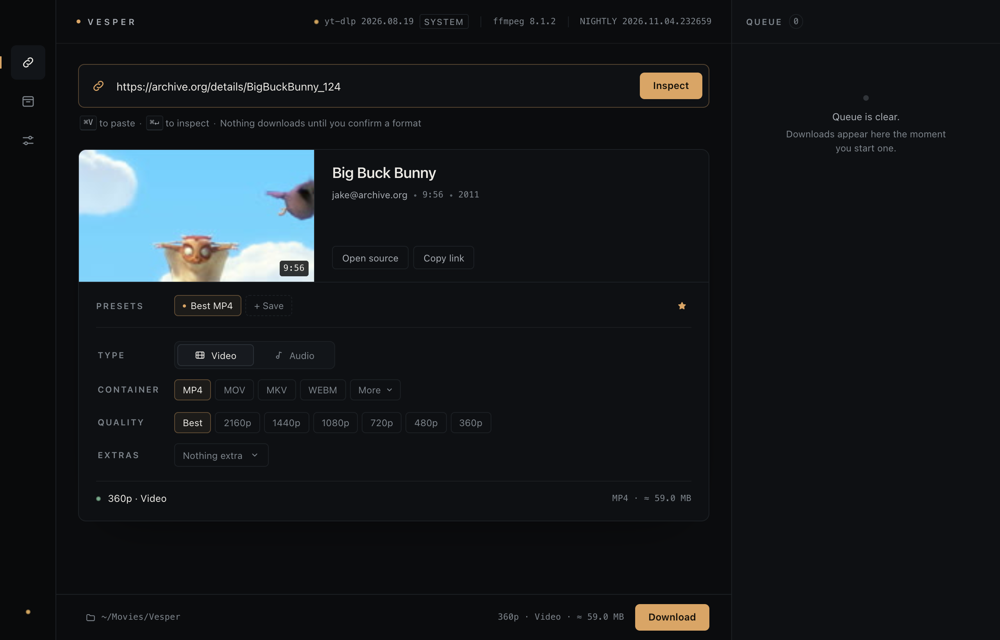

# Vesper

A quiet macOS app for [yt-dlp](https://github.com/yt-dlp/yt-dlp). Paste a link, read what
it actually is, choose a format, and keep the queue in sight.



Vesper is a native macOS window (Swift + WKWebView) wrapped around a small local server.
The Node runtime ships inside the app, so there is nothing to install first. No account,
no telemetry, no cloud.

## Install

1. Download `Vesper-1.0.0.dmg` from [Releases](https://github.com/K3Tamaa/vesper/releases).
2. Optionally verify it:
   ```sh
   shasum -a 256 -c SHA256SUMS
   ```
3. Open the DMG and drag **Vesper** into **Applications**.

Vesper is signed ad-hoc rather than with an Apple Developer ID, so the first launch needs
one extra step: right-click `Vesper.app` in Applications, choose **Open**, then confirm.
macOS remembers the choice. After that the app launches normally.

Requirements: macOS 13 or newer, on Apple silicon or Intel. The DMG is a universal build
and includes its own Node runtime — no Node, Homebrew, or Xcode needed.

### First run

Vesper installs the two tools it drives, from inside the app:

| Tool | Purpose | Source |
|---|---|---|
| `yt-dlp` | reads links and downloads media | GitHub releases (`yt-dlp-nightly-builds` or `yt-dlp`) |
| `ffmpeg` + `ffprobe` | merges video with audio, extracts audio | `ffmpeg.martin-riedl.de` static macOS builds |

Every archive is checked against the publisher's published SHA-256 before it is made
executable. Both installs are one click each from the first-run card, or **Install both**.
Tools go into `~/Library/Application Support/Vesper/bin/` and can be reinstalled at any
time from Settings; yt-dlp can also be updated whenever a newer build appears.

## What it does

- **Reads before it writes.** Every link is inspected first; nothing downloads until you
  pick a format. Video, playlist, and audio links all work.
- **A format composer, not a wall of flags.** Choose Video or Audio, then a common
  container (MP4, MOV, MKV, WEBM / MP3, M4A, WAV, FLAC), with the less common ones
  behind a *More* menu (AVI, FLV / OPUS, OGG, AAC, AIFF, ALAC). Video quality and audio
  bitrate follow the choice.
- **Extras that map to real yt-dlp flags.** SponsorBlock (mark or remove), format
  sorting (H.264, AV1, smallest), metadata, thumbnail and subtitle embedding, chapters,
  and a youtube-dl compatibility toggle.
- **Your own presets.** Save the current setup under a name, apply it in one click, and
  mark it as the default for new links.
- **Owns its yt-dlp.** Switch between the nightly and stable channels, check the channel
  head, and install a build. The header always states which build is running and where
  it came from.
- **Shows real progress.** Percent, transferred bytes, speed, ETA, and fragment counts
  are parsed from yt-dlp itself and streamed to the interface.
- **Keeps a queue.** Two jobs run at once by default (1–4 configurable). Jobs can be
  canceled, retried, revealed in Finder, and cleared. The queue survives restarts.
- **Remembers the archive.** Finished files stay listed with size, date, and a Reveal
  action. Clearing the archive never deletes the files.
- **Updates itself.** **Vesper → Check for Updates…** (or the button in Settings) reads
  the latest GitHub release, verifies the DMG against `SHA256SUMS`, and — after you
  confirm — replaces the app and reopens it. Settings, queue, and files stay untouched.

## Privacy

Vesper is built to need nothing from you but a link.

- **No telemetry.** No analytics, no crash reporting, no identifiers, no pings. Nothing
  about how you use the app leaves the machine.
- **No logs.** The app writes no log file. The native shell sends the local server's
  output to `/dev/null`; set `VESPER_LOG=/path/to/file` only if you are debugging a build.
- **Loopback only.** The embedded server binds to `127.0.0.1` and is reachable only from
  this Mac. It is not exposed to the network.
- **Short list of outbound hosts**, and only for the work you asked for:
  - `api.github.com` and `github.com` — release metadata and tool/update downloads.
  - `ffmpeg.martin-riedl.de` — ffmpeg and ffprobe archives, when you install them.
  - the site behind each link you paste — handled by yt-dlp, exactly as if you had run it
    yourself.
- **Your files stay yours.** Settings, queue, and archive are small JSON files in your
  Application Support folder. Nothing is uploaded, synced, or shared.

## Keyboard

| Shortcut | Action |
|---|---|
| `⌘V` | Paste a link |
| `⌘↵` | Inspect the link |
| `⌘1` / `⌘2` / `⌘3` | Inspect / Archive / Settings |
| `Esc` | Clear the stage, or close the queue drawer |
| `⌘R` | Reload the interface |
| `⌘⇧O` | Open the same view in your browser |

## Where things live

| Path | Contents |
|---|---|
| `~/Library/Application Support/Vesper/settings.json` | Preferences and presets |
| `~/Library/Application Support/Vesper/history.json` | Archive entries |
| `~/Library/Application Support/Vesper/jobs.json` | Queue state |
| `~/Library/Application Support/Vesper/bin/` | Managed yt-dlp, ffmpeg, ffprobe |
| `~/Library/Application Support/Vesper/updates/` | Downloaded update, removed after install |
| `~/Movies/Vesper/` | Default download folder |

To remove Vesper completely, drag the app to the Trash and delete
`~/Library/Application Support/Vesper`. Downloads are never touched.

## Building from source

The DMG is built from this repository; nothing in it is downloaded after the fact except
the pinned Node tarballs, which are checksum-verified at build time.

```sh
sh mac/build.sh     # self-contained universal Vesper.app in the repo root
sh mac/dmg.sh       # dist/Vesper-<version>.dmg + dist/SHA256SUMS
```

Build requirements: macOS 13+, Xcode Command Line Tools, `curl`, `hdiutil`. Node is
fetched for both architectures and merged with `lipo`; the app is ad-hoc signed.

```
server.mjs            Node server and API (loopback only)
lib/                  yt-dlp and ffmpeg resolution, probing, queue, updater
public/               interface (vanilla HTML/CSS/JS)
mac/Vesper.swift      native shell, window, menu, process lifecycle
mac/build.sh          universal app build
mac/dmg.sh            disk image packaging
VERSION               single source of truth for the version
```

To run the interface without building the app:

```sh
npm start          # http://127.0.0.1:4173
```

### API, for reference

- `GET /api/state` — settings, queue, archive, tool and app status
- `GET /api/stream` — Server-Sent Events for jobs, status, install progress
- `POST /api/probe` — `yt-dlp -J` metadata, normalized
- `POST /api/download` — enqueue a job
- `POST /api/jobs/:id/(cancel|retry|remove|reveal)`
- `POST /api/binary/(check|install)`, `/api/ffmpeg/install`
- `POST /api/app/update/(check|download|install)`
- `POST /api/settings`, `/api/history/*`, `/api/open`, `/api/reveal`, `/api/thumb`

URLs are always passed to yt-dlp as a single argv entry after `--`, never through a
shell. The interface has no remote dependencies.

## Notes

- Playlist downloads run as one job and honor the item selection.
- Live streams show an indeterminate progress bar until the byte total is known.
- Sizes are estimates from yt-dlp metadata and are labelled with `≈`.
- Vesper is a front end, not a replacement: format availability, site support, and
  extraction fixes come from yt-dlp itself.

## License

MIT — see [LICENSE](LICENSE).
